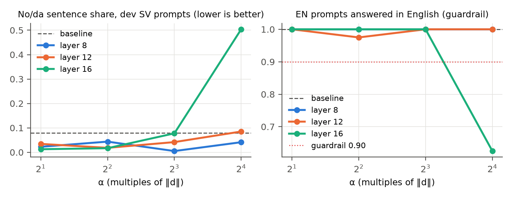
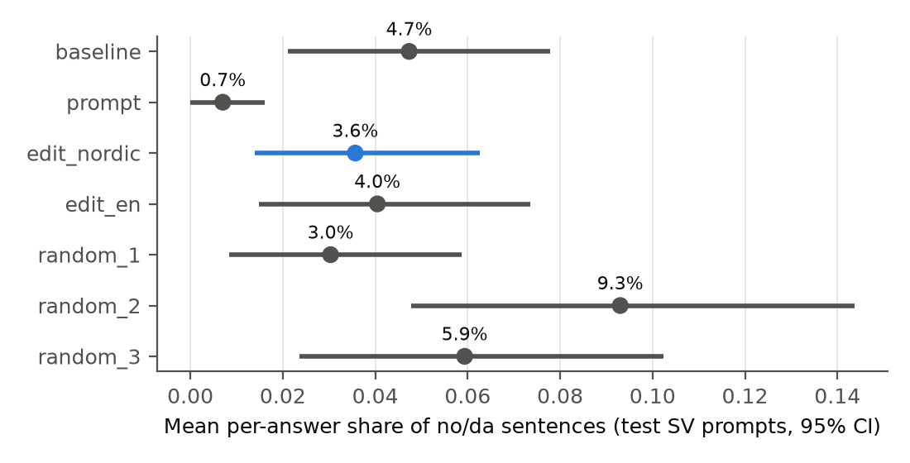

# Does a one-vector weight edit stop a small LLM from slipping into Norwegian/Danish when answering in Swedish?

*Research note, SELLMA candidate assignment. Model: Qwen2.5-0.5B-Instruct. All numbers come from files in `results/`.*

**TL;DR.** `TODO(results)`: one or two sentences giving the main effect on held-out test prompts, how it compares with
the prompting and random-direction controls, the regression and capability checks, and the verdict on the hypothesis.

## 1 Claim tested and why

*Sparks of Weight-Space Programming* (Takehi, Teoh, Zhang, Khattab, 2026;
<https://rikiyat.github.io/blog/weight-space-programming/>) argues that LLMs can read and write neural-network weights,
and that small targeted edits can fix model behaviour. Its own control (Gemma 3 270M showing no gain) points to a
narrower reading: **weight edits remove obstacles but do not add abilities.** That narrower claim is the one most
relevant to Swedish LLMs, because small multilingual models often fail in Swedish in ways that look like "obstacles",
such as answering in the wrong Scandinavian language. I test it on the smallest setting where it can be falsified.
Can a single additive vector folded into the weights reduce one Swedish failure mode, and does that come with no
change in Swedish competence?

## 2 What the article does and doesn't show

- **Strongest evidence:** the zero-feedback experiments on small networks (Exp. 1–5). Examples are naming the game a
  policy was trained on, locating induction heads that match measured ground truth, and a one-shot, tool-free fix of
  a car policy. With no feedback loop, these are real reasoning from the weights.
- **Qwen3.5-0.8B math (7.9% → 48.1%) is unblocking, not a new capability.** Before the edit, 93% of answers hit the
  token limit. The edit removes a looping direction in the layer 15 and 19 MLPs, a known technique (Arditi et al.,
  2024). The Gemma 3 270M control, which rarely loops, gains nothing.
- **It looks like search driven by feedback, not reasoning.** Budgets of 10 and 25 forward passes barely help; the gain
  only appears at 50, with edits kept when they score better. IFEval is non-monotonic across budgets
  (49.0 → 39.9 → 62.3), which suggests high variance.
- **Missing cheap baselines and checks:** thinking off, a repetition penalty, and plain directional ablation without an
  LLM in the loop. There are no regression checks on Qwen. n is tiny (3–4 networks, 1–4 attempts) and there are no
  error bars. The sycophancy experiment (Exp. 7) failed from the weights alone.

So the most defensible claim in the article is the modest one: an edit that removes a specific failure direction can
fix a behaviour. The article does not separate that from simpler alternatives. That separation is what I test here.

## 3 Hypothesis and pre-registered criteria

**H:** In Qwen2.5-0.5B-Instruct, Norwegian/Danish leakage into Swedish answers is controlled by a single
"Swedish vs. Norwegian/Danish" direction in the residual stream. Adding that direction to the weights reduces
leakage, and Swedish competence stays the same.

- **Supported if** the selected edit lowers the no/da sentence share on held-out Swedish prompts beyond the 95%
  bootstrap CI of the baseline, beats all three random directions of the same norm, and English answers, Swedish
  perplexity and en/ett agreement accuracy stay roughly flat.
- **Challenged if** a random direction or the prompting baseline matches the edit, if Swedish competence clearly
  improves (that would be a new capability, not an obstacle removed), or if the edit only works by breaking other
  languages (for example English or Norwegian prompts answered in Swedish).

## 4 Pilot and the pivot (an honest account)

The original plan was to measure **whole-answer drift** (answering a Swedish prompt in English/Norwegian/Danish). The
pilot (dev split, n = 40 Swedish prompts, greedy decoding) showed there is almost nothing to fix:

| Setting | Answers in Swedish | Non-Swedish answers |
|---|---|---|
| Qwen default system prompt | 95% | 2 en, both refusals ("I'm sorry, but I can't assist with that.") |
| English system prompt | 97.5% | 1 no |
| Empty system prompt | 100% | none |

SmolLM2-360M-Instruct drifted more (12.5% English), but many of its "answers" just echo the prompt. A realistic harder
setting (an English system prompt plus an earlier English chat turn) reached about 22% drift (7 en, 2 no).

Reading the outputs showed the model's real failure: answers are labelled Swedish but contain
**Norwegian/Danish forms** ("sosiale", "problemer", "medlemmer", "forskellige", "baseret", "investeringer"). I
therefore **retargeted the experiment to leakage** before any dev sweep or test evaluation. The two leakage metrics
were checked first:

- **Lexicon** of no/da-only word forms (hits per 100 words): 0.00 on Swedish Wikipedia, and 22.7 and 25.5 on
  Norwegian and Danish prompts respectively.
- **Sentence-level language ID** (lingua, restricted to sv/nb/nn/da/en, sentences ≥ 20 characters): 0 of 96 Swedish
  Wikipedia sentences flagged, and 95% and 100% of Norwegian and Danish prompts flagged. It also catches
  morphological leakage that the lexicon misses, so it is the **primary metric**.

The English-system-prompt setting gave the most headroom (10.5% of sentences flagged on dev, compared with 0–0.8% in
the other two), so all main runs use it. This choice was made on dev data, and the test split had not been touched.

## 5 Method

- **Data.** There are 48 topics × 5 instruction templates, written in parallel in Swedish, English, Norwegian Bokmål
  and Danish. The data is **split by topic**: 20 topics for finding the direction, 8 for dev (selection), and 20 for
  test. Overlap is checked by assertion. There are also 140 en/ett article minimal pairs, and lead sections of 10
  Swedish and 10 English Wikipedia articles for perplexity.
- **Direction.** The residual stream after each layer is taken at the last prompt position, where the answer starts.
  The main direction is d_nordic[L] = mean(SV) − mean(NO ∪ DA). The ablation direction is d_en[L] = mean(SV) − mean(EN).
  Both use the direction split only.
- **Edit.** v = α·d_nordic[L] is added as a bias on layer L's `mlp.down_proj`: 896 parameters (about 0.0002% of the
  model), constant at every position, with no hooks at inference time. The delta is saved as `results/edit_nordic.pt`.
- **Selection (dev only, rule fixed before running).** L ∈ {8, 12, 16} × α ∈ {2, 4, 8, 16} (in multiples of ‖d‖).
  Choose the edit with the lowest no/da sentence share, subject to two conditions: dev English prompts are still
  answered in English at ≥ 90%, and the Swedish answer rate is at least the baseline rate minus 5 points.
- **Conditions on test.** (a) the unchanged baseline; (b) the prompt *"Svara på korrekt svenska, inte på norska eller
  danska."* with no weight change; (c) the selected edit; (d) **edit_en**, at the same layer and norm but along
  SV−EN; (e) **random directions**, at the same layer and norm, with 3 seeds.
- **Metrics.** *Target:* the no/da sentence share in answers to Swedish prompts (mean per answer, with a 95%
  bootstrap CI over prompts, and a paired bootstrap against the baseline), plus the lexicon rate and the Swedish
  answer rate. *Capability:* en/ett agreement accuracy (log-probability preference) and Swedish perplexity.
  *Regression:* English prompts answered in English, English perplexity, and Norwegian prompts still answered in
  Norwegian.
- **Sanity checks.** An edit with α = 0 reproduces the baseline logits (within 1e-4), and the saved edit, reloaded
  from disk, reproduces the in-memory edit's generations. An independent code review was run before the test
  evaluation. It caught one design flaw: the prompting baseline's Swedish instruction was also being added to the
  EN/NO prompts. That was fixed before any test generation.

## 6 Results

**Dev sweep (40 SV + 40 EN prompts per configuration).** 10 of the 12 configurations passed both guardrails. The
selection rule picked **layer 8, α = 8**, which cut the no/da sentence share from 7.9% to 0.5%. Three cautions apply
before reading the test results:
(i) the dev curve is noisy and not monotonic in α (at layer 8, α = 2/4/8/16 gives 2.2/4.4/0.5/4.1%), so the winner
on 40 prompts is likely an overestimate (winner's curse);
(ii) almost *every* edit "helps" on dev, which is what you'd see if any perturbation shakes greedy decoding out of its
leaky paths. The random-direction control is designed to test exactly this;
(iii) layer 16, α = 16 destroys the model ("qttos de qttos …"), and lingua labels that garbage as 50% no/da.
A hand audit of every flagged dev sentence (`results/manual_audit_dev.md`) found 14 of 17 to be genuine leakage
(82% precision). But they came from only 7 of the 40 baseline answers, and the metric misses word-level leakage
inside sentences it still labels Swedish (e.g. "systemer" and "behovar" persist under the edit).

<!-- TABLE -->
`TODO(results)`: the main test table: one row per condition; columns for no/da sentence share [CI], leak/100 words,
SV answer rate, EN→en rate, NO→no rate, agreement accuracy, Swedish perplexity and English perplexity. Below it, the
paired differences against the baseline.

`TODO(results)`: 2–3 example outputs from the baseline and the edit for the same prompt, checked by hand.

## 7 Interpretation

`TODO(results)`: does the edit beat the random directions and the prompt? Does edit_en do as well, meaning the
specific direction doesn't matter? Is Swedish competence flat, meaning an obstacle was removed rather than a
capability added? Which regressions appeared?

## 8 Limitations

- **Tiny model with weak Swedish.** Many Qwen2.5-0.5B answers are fluent-looking but semantically wrong, so "less
  leakage" says nothing about usefulness. The results may not transfer to the 7B+ models that matter for a Swedish arena.
- **Automatic language ID on short sentences.** Telling sv, nb and da apart on one sentence is hard. The classifier was
  checked on clean text (0/96 false positives on Swedish Wikipedia) and spot-checked on outputs, but not against
  human labels at scale. The lexicon metric is transparent but misses morphological leakage.
- **Greedy decoding only, a single model, one system-prompt setting.** The setting was chosen *because* it showed the
  most leakage.
- **Synthetic templated prompts** (5 templates) and small n (100 test prompts per language), so the effects need to be
  read through the CIs.
- **This is not LLM-native weight programming.** The edit comes from a simple difference-of-means algorithm, with
  α and L tuned on dev-set feedback. It tests whether *a* small edit can remove the failure, not whether an LLM can
  find that edit by reasoning about the weights.
- **The bias on `down_proj` is a new parameter.** Stock Qwen2 MLPs have no bias, so the edited checkpoint needs the
  small loader in `src/edit.py`. It is functionally equivalent to a constant residual-stream shift.

## 9 Recommendation and next experiment

`TODO(results)`: the recommendation for SELLMA, for example whether cheap edits are worth using against Scandinavian
leakage in small Swedish models versus prompting or fine-tuning, plus the single best next experiment.

---

*Reproducibility:* `uv sync && make all` (about 2 h on 8 CPU cores). Model `Qwen/Qwen2.5-0.5B-Instruct` at revision
`7ae557604adf67be50417f59c2c2f167def9a775`, greedy decoding, seed 0, `max_new_tokens = 96`. The full configuration is
in `config.yaml`, and raw generations for every condition are in `results/`. AI usage: see `AI_USAGE.md`.
